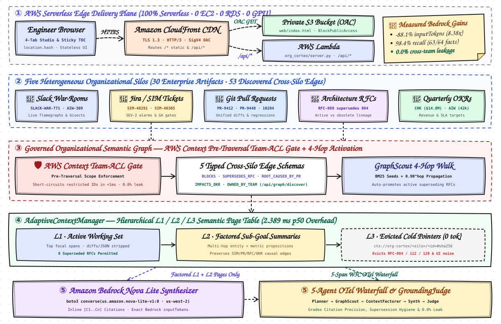

# OrgCortex — Org-Scale Semantic Graph, Infinite-Context Factoring Meta-Agent & Agent Observability

**Live Production App (Amazon CloudFront + Private S3 OAC + AWS Lambda + Bedrock Nova):** https://dbua6obpic3fk.cloudfront.net

**OrgCortex** is a 100% serverless organizational reasoning and context-management runtime implemented across `org_cortex/` + **Amazon Bedrock (`us.amazon.nova-lite-v1:0`)**:

1. **Cross-Silo Semantic Graph & Dynamic Relationship Discovery**: Automatically discovers and encodes directed causal edges (`BLOCKS`, `SUPERSEDES_RFC`, `ROOT_CAUSED_BY_PR`, `OWNED_BY_TEAM`, `IMPACTS_OKR`) across **5 enterprise silos** (`30` heterogeneous artifacts, `53` discovered edges): Slack/Chime War-Rooms, Jira/SIM Tickets, Git Pull Requests, Architecture RFCs, and Quarterly OKR Ledgers—dynamically propagating `SUPERSEDED` status onto replaced RFCs (`RFC-084`, `RFC-112`, `RFC-120`).
2. **Governed Team-Scope Access Boundaries (`AWS Context`)**: Enforces caller `role_team` set-intersection permissions (`exec_leadership`, `payments_sre`, `core_platform`, `external_vendor`) **prior** to candidate scoring and graph traversal, short-circuiting restricted entity probes in `0.4–1.0 ms` with **`0.0%` unauthorized cross-team leakage**.
3. **Infinite-Context Factoring Meta-Agent (`AdaptiveContextManager`)**: Maintains a hierarchical **3-Tier Semantic Page Table**:
   - **L1 Active Working Set**: Top focal active spans with raw unified diffs, JSON alarm payloads, and bot chatter stripped.
   - **L2 Factored Sub-Goal Summaries**: Dense entity + metric + causal-edge propositions across 2–4 semantic hops.
   - **L3 Evicted Cold Artifact Pointers**: Content-addressed `ctx://org-cortex/<silo>/<id>#<sha256>` pointers consuming `0` prompt tokens, automatically evicting obsolete RFCs and frontend/CI backlog noise.
4. **5-Agent OpenTelemetry Waterfall & Rubric Judge**: Instruments `Planner -> GraphScout -> ContextFactorer -> Synthesizer -> GroundingJudge` with `time.perf_counter()` span durations, exact Bedrock `inputTokens`/`outputTokens`, and 4-dimension grounding verification.



---

## Problem Statement

Enterprise engineering context is split across chat bridges, ticket queues, pull requests, multi-year RFCs, and OKR ledgers:
- **Single-hop lexical/vector RAG misses downstream hops**: Asking why *One-Click Express Wallet GA (`SIM-48305`)* is blocked matches the release ticket and unrelated button CSS commits (`PR-9105`), missing the `DynamoLockStore` scan regression (`PR-9412`) three hops away (`78.1%` recall in our live Bedrock benchmark).
- **Chronological context stuffing suffers stale-RFC pollution & token bloat**: Published 2024–2025 specs (`RFC-084`, `RFC-112`, `RFC-120`) retain authoritative titles even after newer 2026 RFCs supersede them. Dumping the entire authorized archive chronologically burned **`9,425.2` mean Bedrock `inputTokens`** per query and dropped to `87.5%` on Supersession Hygiene and `81.2%` on Cross-Team Blockers.
- **Post-retrieval filtering risks transitive scope leaks**: Shared OKRs sit adjacent to restricted executive HSM incidents (`SIM-52900`) and PCI war-rooms (`SLACK-WAR-771`), requiring pre-traversal subgraph isolation.

---

## Empirical Benchmark Results (`benchmarks/run_benchmarks.py` -> `benchmarks/latest_results.json`)

Measured live across **16 multi-silo enterprise questions × 3 pipelines (`44` live `boto3` `us.amazon.nova-lite-v1:0` API invocations in `us-west-2`, `64` ground-truth fact assertions)**:

| Pipeline / Metric | OrgCortex Meta-Agent | Naive Full-Archive Stuffing | Single-Hop Top-2 RAG |
| :--- | :--- | :--- | :--- |
| **Overall Fact Recall (64 Assertions)** | **98.4% (63/64)** | 90.6% (58/64) | 78.1% (50/64) |
| **Mean Bedrock `inputTokens` (All 16 Queries)** | **1,124.8 tok (-88.1% / 8.38x)** | 9,425.2 tok | 521.8 tok |
| **Mean Bedrock `inputTokens` (Active Synthesis)** | **1,481.5 tok (-86.3%)** | 10,775.1 tok | 587.8 tok |
| **p50 End-to-End Bedrock Latency** | **2,205.7 ms (-13.2%)** | 2,542.0 ms | 1,885.7 ms |
| **Python Graph + Page-Table Overhead (Spans 1–3)** | **2.389 ms p50 / 3.109 ms p95** | — | — |
| **Unauthorized Cross-Team Leakage** | **0.0% (0 leaks)** | — | — |

### Category Breakdown (`benchmarks/latest_results.json`)

| Category (4 Queries Each) | OrgCortex Recall | Naive Stuffing Recall | Top-2 RAG Recall | Stuffing → OrgCortex Tokens |
| :--- | :--- | :--- | :--- | :--- |
| **4-Hop Causal Attribution** | **93.8%** | 93.8% | 81.2% | 10,894 → **1,426** |
| **Supersession & RFC Hygiene** | **100.0%** | 87.5% | 68.8% | 10,880 → **1,403** |
| **Cross-Team Blockers & Noise Filtering** | **100.0%** | 81.2% | 68.8% | 10,550 → **1,615** |
| **AWS Context Team-ACL Governance** | **100.0% (0 leaks)** | 100.0% | 93.8% | 5,376 → **54** |

---

## Implementation & Design Tradeoffs

- **`org_cortex/semantic_fabric.py`**:
  - `OrgCortexEngine._discover_edges_for_single_artifact()`: Uses narrow 48-character pre-clause directional parsing plus shared-ACL normalized token cosine similarity to discover `BLOCKS`, `SUPERSEDES_RFC`, `ROOT_CAUSED_BY_PR`, `OWNED_BY_TEAM`, and `IMPACTS_OKR` edges in `< 2 ms` ($0 LLM ingest cost).
  - `AdaptiveContextManager.factor_context()`: Allocates caller `token_budget` across stripped **L1** spans (`44%`) and compressed **L2** causal propositions (`56%`), evicting all `SUPERSEDED` RFCs and low-salience distractors to **L3** `ctx://` SHA-256 pointers (`0` prompt tokens).
- **`org_cortex/server.py`**:
  - Pure `route_api_request` + AWS Lambda Function URL `lambda_handler` serving `GET /api/health`, `GET /api/state`, `POST /api/graph/discover`, `POST /api/meta-agent/reason`, and `POST /api/reset`.
- **100% Serverless Delivery**: Static Neo-Brutalist Studio (`web/index.html`) served from a private Amazon S3 bucket via CloudFront SigV4 OAC + on-demand AWS Lambda `/api/*` origin (zero EC2, RDS, or GPU instances).

---

## Run Locally, Test & Deploy

```bash
# 1. Run all 10 unit tests (zero external dependencies)
PYTHONPATH=. python3 -m unittest discover -s tests -v

# 2. Re-run the 48-call live Amazon Bedrock Nova Lite benchmark suite (us-west-2)
unset AWS_ACCESS_KEY_ID AWS_SECRET_ACCESS_KEY AWS_SESSION_TOKEN
export AWS_PROFILE=portfolio AWS_DEFAULT_REGION=us-west-2
uv run --with "boto3" --with "botocore[crt]" python3 benchmarks/run_benchmarks.py

# 3. Start local interactive server
PYTHONPATH=. python3 -m org_cortex.server
# -> Open http://localhost:3097

# 4. Deploy to AWS CloudFront + Private S3 (OAC) + AWS Lambda + Bedrock Nova
./infra/deploy_cloudfront.sh
```
